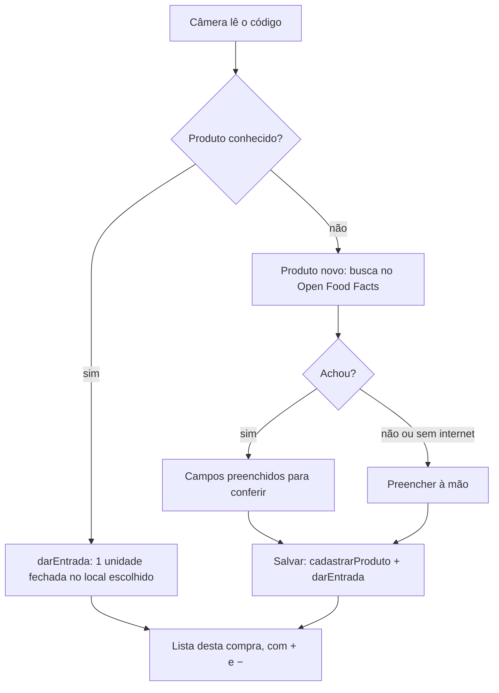
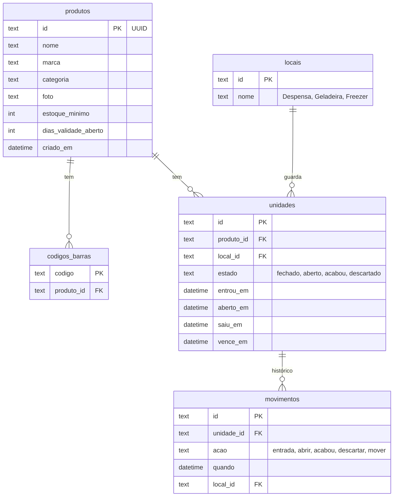
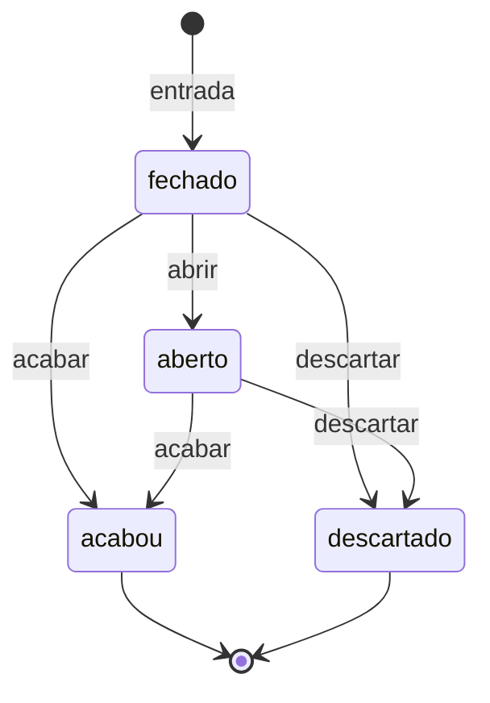

# Arquitetura

Como o Chronos Home está organizado por dentro. As decisões e o porquê de cada uma estão em
[CONTEXTO.md](CONTEXTO.md).

## Pastas

```
lib/
  main.dart              início do app: tema, cores, banco e Open Food Facts
  dados/
    tabelas.dart         as tabelas do banco (drift) e os enums de estado
    banco.dart           o banco e as regras (entrada, abrir, acabou, descartar, mover)
    banco.g.dart         código gerado pelo drift: não editar à mão
    abrir_banco.dart     abre o arquivo com SQLCipher e cuida da chave no Keystore
  servicos/
    open_food_facts.dart nome, marca, categoria e foto pelo código de barras
  telas/
    inicio.dart          o estoque (o que tem em casa) e o botão Compras
    compras.dart         bipar o que chegou do mercado
    produto_novo.dart    cadastro de um código que o app não conhece
  componentes/
    erro_da_camera.dart  mensagem legível quando a câmera não abre
test/
  banco_test.dart        regras de estado, estoque e migrações do banco
  open_food_facts_test.dart  leitura das respostas do Open Food Facts (simuladas)
  widget_test.dart       telas Início e Produto novo, e o SQLCipher
android/                 projeto Android (ícone, nome, NDK, permissões)
docs/                    documentação
```

Regras gerais:
- **`dados/` e `servicos/` não conhecem telas**; as telas falam com o banco só pelos métodos de
  `Banco`. Assim as regras são testadas sem celular.
- Serviços de internet recebem o cliente HTTP no construtor, para os testes simularem as respostas
  sem rede.

## Fluxo de Compras



## Banco de dados

SQLite pelo [drift](https://drift.simonbinder.eu/), com SQLCipher. Esquema atual: **versão 3**.



- Cada **unidade física** (um pote, uma lata) é uma linha em `unidades`. A quantidade em casa é a
  contagem das unidades fechadas ou abertas.
- Os ids são **UUID**, para um dia sincronizar mais de um celular sem conflito.

## Regras de estado



- Qualquer outra transição lança `TransicaoInvalida`, e nada fica gravado pela metade (cada
  operação roda numa transação).
- Toda mudança gera uma linha em `movimentos`, usada depois para gráficos e desperdício.
- **Ao bipar para abrir**, o app escolhe a unidade fechada que vence primeiro; sem validade, a
  mais antiga.
- **Ao bipar para acabar**, escolhe a unidade aberta há mais tempo; se não houver, a próxima a abrir.

## Migrações

`schemaVersion` fica em `lib/dados/banco.dart`. Ao mudar o esquema:

1. Suba a versão e escreva o passo em `onUpgrade` (nunca apague dados do usuário).
2. Rode `dart run build_runner build`.
3. Escreva um teste que crie o banco da versão anterior e confira o novo
   (veja o teste de migração em `test/banco_test.dart`).

| Versão | Passo | Mudança |
|---|---|---|
| 1 | 2 | tabela `leituras` (prova da câmera) |
| 2 | 3 | `produtos`, `codigos_barras`, `locais`, `unidades`, `movimentos` e locais padrão |
| 3 | 4 | sai a tabela `leituras` |

## Criptografia

- O pacote `sqlite3` baixa o **SQLCipher** no lugar do SQLite comum, configurado no fim do
  `pubspec.yaml` (`hooks: user_defines: sqlite3: source: sqlcipher`).
- A chave do banco são 32 bytes aleatórios criados na primeira abertura e guardados no
  **Android Keystore** pelo `flutter_secure_storage`. Ela nunca aparece no código nem no git.
- Ao abrir, o app confere que o SQLCipher foi carregado; se não foi, recusa abrir para não gravar
  sem criptografia.
- Perder a chave (ex.: limpar os dados do app) é perder o banco. O backup do passo 10 vai tratar
  disso.
